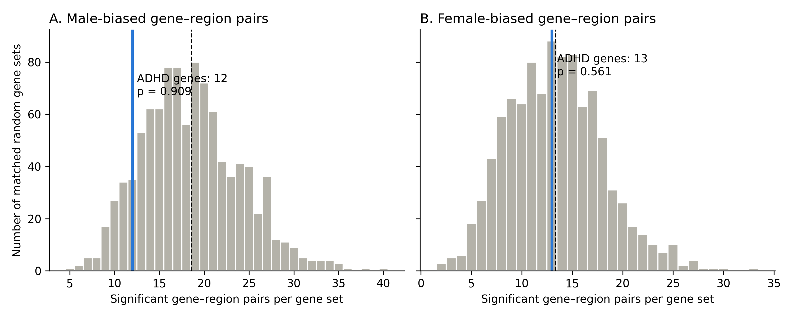

# Sex-Biased Brain Expression of ADHD Risk Genes

Final project for IB 134L Practical Genomics (UC Berkeley, Fall 2026).

## Question

ADHD is diagnosed two to three times more often in males. This project tests whether ADHD risk genes are expressed differently in male (XY) and female (XX) brains, using adult brain RNA-seq from GTEx.

**Hypothesis:** ADHD risk genes are enriched for male-biased expression in attention- and reward-related brain regions, compared with random genes matched on expression level, gene length, and GC content.

## Data

Data files are not included in this repository. Download them into a `data/` folder:

| File | Source |
|---|---|
| `GTEx_Analysis_2026-05-19_v11_RNASeQCv2.4.3_gene_reads.gct.gz` | [GTEx Portal](https://gtexportal.org) → Downloads → Bulk tissue expression (V11) |
| `GTEx_Analysis_v11_Annotations_SampleAttributesDS.txt` | GTEx Portal → Downloads → Metadata (V11) |
| `GTEx_Analysis_v11_Annotations_SubjectPhenotypesDS.txt` | GTEx Portal → Downloads → Metadata (V11) |
| `ensembl_genes.tsv` | [Ensembl BioMart](https://www.ensembl.org/biomart): Human genes (GRCh38) — gene ID, name, chromosome, start, end, % GC, gene type |
| `demontis2023_supp_tables.xlsx` | Supplementary Tables from Demontis et al. (2023), *Nature Genetics* 55:198–208 (sheet 7: genes mapped by credible sets) |

Raw GTEx reads: SRA SRP012682, dbGaP phs000424 (controlled access; not used directly).

## Pipeline

| Step | Notebook | What it does |
|---|---|---|
| 1 | `analysis_python.ipynb` | Selects GTEx samples from five brain regions (frontal cortex BA9, anterior cingulate BA24, caudate, putamen, nucleus accumbens) |
| 2 | `analysis_python.ipynb` | Confirms chromosomal sex with XIST and RPS4Y1 expression, removes Y-chromosome genes and XIST, checks for outliers with PCA, filters low-expression genes |
| 3 | `deseq2.ipynb` (R) | Runs DESeq2 in each region: `~ age + RIN + ischemic time + sex` |
| 4 | `analysis_python.ipynb` | Builds random gene sets matched to ADHD genes on expression, length, and GC content |
| 5 | `analysis_python.ipynb` | Permutation test (1,000 matched sets), run separately for male- and female-biased genes; Figure 1 and Table 1 |

Run order: Python steps 1–2 → R notebook → Python steps 4–5.

## Results

- 1,338 brain samples (334 XX, 1,004 XY) across five regions; 3 samples removed after the chromosomal sex check.
- ADHD risk genes (76 genes; 68–70 tested per region) showed **no enrichment** for sex-biased expression:
  - Male-biased gene–region pairs: 12 observed vs. 18.6 expected (p = 0.909)
  - Female-biased gene–region pairs: 13 observed vs. 13.3 expected (p = 0.561)

## Requirements

- Python 3.9+: `pandas`, `numpy`, `matplotlib`, `openpyxl`
- R 4.x: `DESeq2` (Bioconductor), `IRkernel` to run the R notebook in Jupyter

## References

- Demontis D, et al. (2023). Genome-wide analyses of ADHD identify 27 risk loci, refine the genetic architecture and implicate several cognitive domains. *Nature Genetics*, 55, 198–208.
- GTEx Consortium (2020). The GTEx Consortium atlas of genetic regulatory effects across human tissues. *Science*, 369, 1318–1330.
- Love MI, Huber W, Anders S (2014). Moderated estimation of fold change and dispersion for RNA-seq data with DESeq2. *Genome Biology*, 15, 550.

## AI use

Claude (Anthropic) was used to help write and debug analysis code. All analysis decisions and interpretations are my own.